<!--
  GitHub PROFILE README for github.com/alystria-ai   (repo: alystria-ai/alystria-ai)
  Kept short on purpose so the contribution graph stays in view; the website has the rest.
  Artwork in assets/ is animated SVG, generated by tools/make_assets.py.
-->

&nbsp;&nbsp;&nbsp;&nbsp;&nbsp;&nbsp;&nbsp;&nbsp;

Characters that listen, talk back in their own voice and remember you. Made by one person, released for free, code you can read.

