<!--
  GitHub PROFILE README for github.com/alystria-ai   (repo: alystria-ai/alystria-ai)
  · All artwork in assets/ is animated SVG (SMIL), generated by tools/make_assets.py.
    Edit the script and re-run it rather than editing the SVGs by hand.
-->

&nbsp;&nbsp;&nbsp;&nbsp;&nbsp;&nbsp;

### Characters that listen, answer in their own voice, remember you, and notice what is happening around them.

Made by one person. Released for free. Code you can read.

## ✦ Where they live

<table>
<tr>
<td width="33%" valign="top">

**In the worlds you already play** 
Game mods where characters talk back by voice or text, travel with you, fight at your side and remember what you said.
</td>
<td width="33%" valign="top">

**Across the board** 
A chess game you can talk through. Animated coaches explain the why behind every move, and have opinions.
</td>
<td width="33%" valign="top">

**On your desktop** 
Little creatures that walk your taskbar, climb your windows, chase your cursor and hold real conversations.
</td>
</tr>
</table>

## ✦ Things you can try

🗡️ **[AI NPC Companions System](https://github.com/alystria-ai/AI-Companion-Mod-For-Blood-of-Dawnwalker)** · *The Blood of Dawnwalker* 
Summon companions who follow Coen, fight with their native abilities and talk by text or voice, with lip sync and group chat. Plus Horde and Nightmare battles, first-person POV and relationships with Anca and Lacra.

🐺 **[Rideable Mount Companions](https://github.com/alystria-ai/Rideable-Mount-Companions)** · *The Blood of Dawnwalker* 
Ride wolves, bears, boars and gargoyles, give them spoken orders, then dismount and fight together. Every beast answers in its own voice.

♟️ **[Chessbuddy](https://github.com/alystria-ai/chessbuddy)** · *play at [chessbuddy.live](https://chessbuddy.live)* 
A chess game you can talk through, with four animated coaches, voice chat, puzzles and post-game analysis.

🐾 **[AI Desktop Pet](https://github.com/alystria-ai/AI-Desktop-Pet)** · *Windows, macOS, Linux* 
Pets that live on your desktop, remember you (if you let them), set reminders and take a look at your screen when you ask.

More is on the way. The best place to see it first is <a href="https://www.youtube.com/@AlystriaAI">YouTube</a>.

## ✦ How they're made

- **Free, and open to read.** Things are released for free, with the code open so you can learn from it, fork it or build your own characters.
- **On your machine, if you like.** Where it is possible, characters think and speak locally. No account, no key, no internet.
- **Presence over polish.** Lip sync, eye contact, a remark about the fight you just won. The small details that make someone feel there.

If something here made you smile, a ⭐ on the repo or a hello on <a href="https://www.patreon.com/cw/AlystriaAI">Patreon</a> goes a long way. Lys, the little one in the banner, lives on <a href="https://alystria-ai.github.io/">the website</a>. You can throw Lys there.

